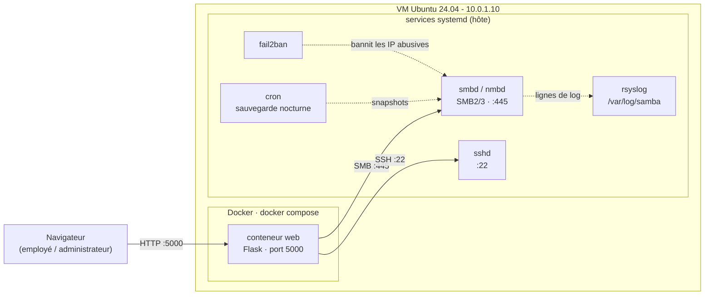
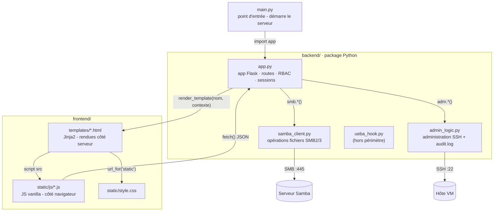
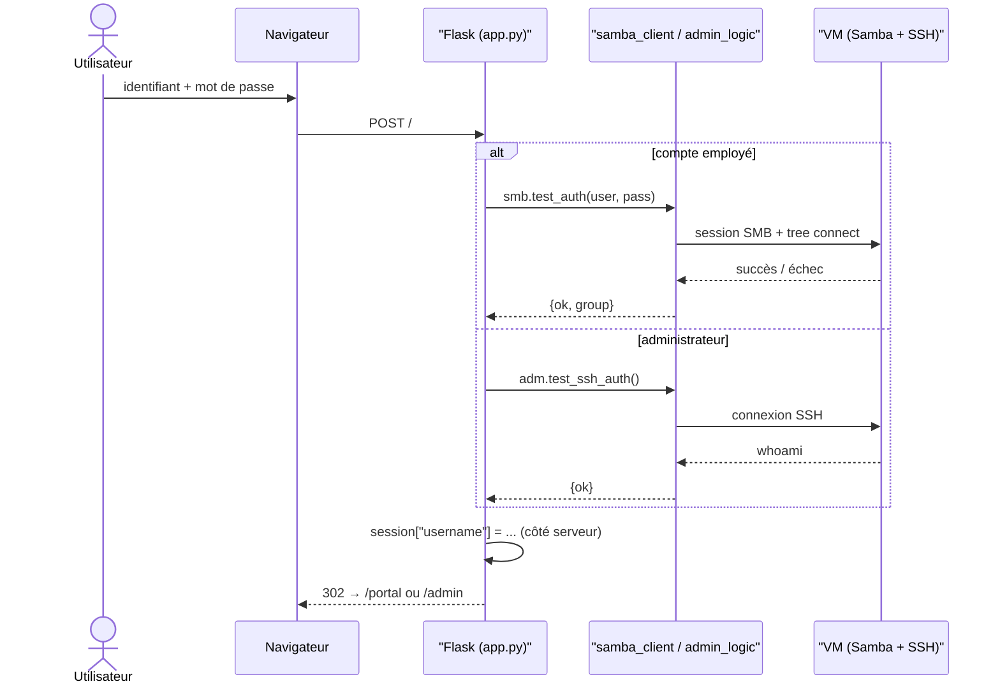
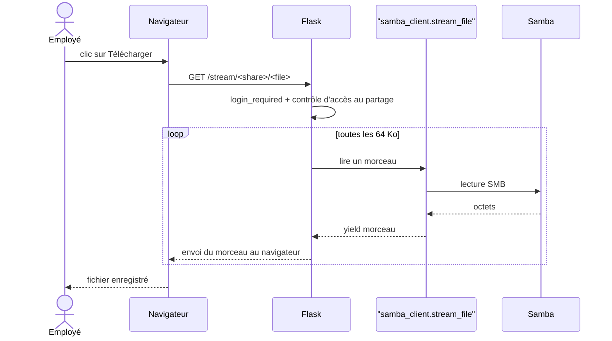
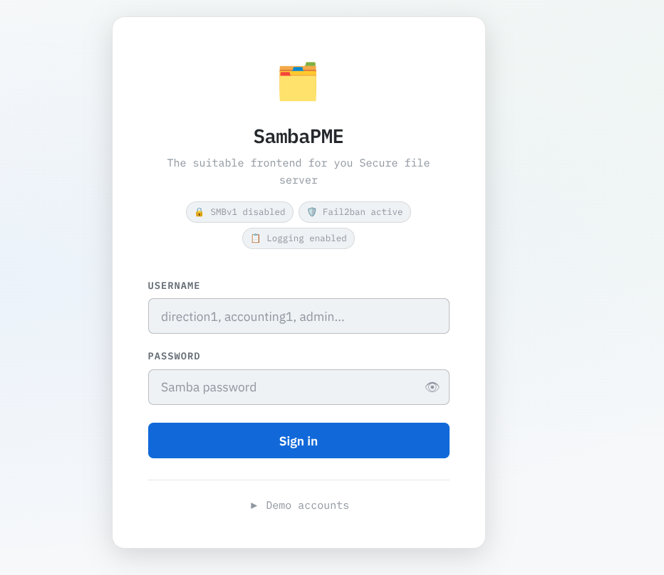
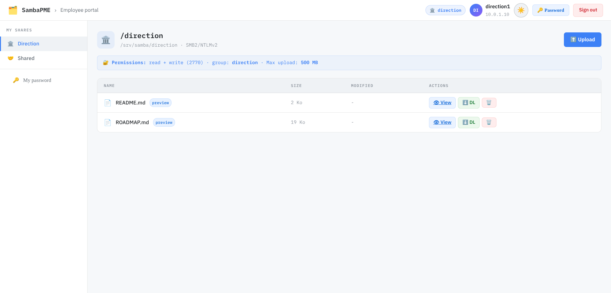
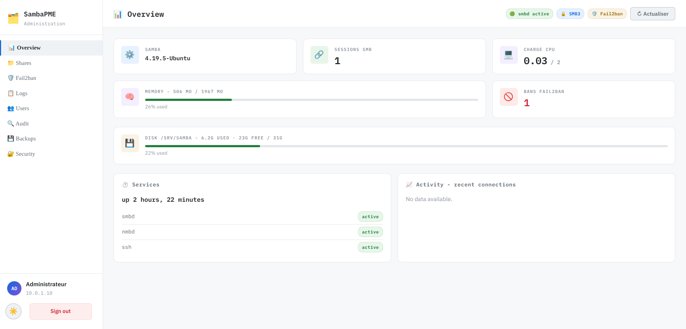
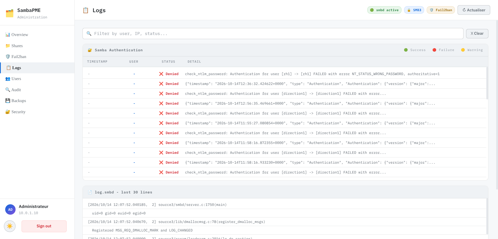
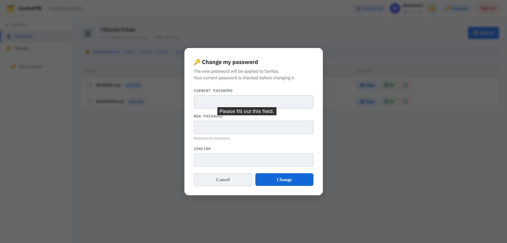

# SambaPME

<div align='center'>
[Read the English version](./README.md)
</div>

**Un portail web pour un serveur de fichiers Samba.** Les employés se connectent et
parcourent les dossiers partagés de leur service ; les administrateurs disposent d'un
tableau de bord pour gérer les comptes Samba, surveiller fail2ban, lancer les
sauvegardes et auditer l'activité - le tout depuis le navigateur.

---

## Contexte

SambaPME simule le portail de partage de fichiers interne d'une petite entreprise
(une *PME*). Un serveur Linux fait tourner **Samba 4** (SMB2/3 avec **chiffrement
obligatoire**) et expose un partage par service (`direction`, `comptabilite`, `rh`,
`technique`) plus un partage commun (`commun`). Le portail permet aux employés de
**lister, uploader, télécharger, prévisualiser et supprimer** des fichiers, et donne
à l'IT un tableau de bord qui pilote le **vrai serveur via SSH** (`smbstatus`,
`pdbedit`, `fail2ban-client`, `systemctl`, le script de sauvegarde…).

L'infrastructure est volontairement réaliste :

- **Samba, fail2ban, les sauvegardes et les logs tournent comme services systemd sur la VM** - le vrai serveur.
- **Seule l'application web est conteneurisée** (Docker) ; elle joint Samba en **SMB** et
  l'hôte en **SSH**.

> Pourquoi ce découpage, et comment tout s'articule ? Voir **[`exp.fr.md`](./exp.fr.md)** pour
> une explication détaillée des choix de conception.

## Architecture



**Les communications, en trois flux :**

| Flux | Chemin | Ce qui se passe |
|------|--------|-----------------|
| **Employé** | navigateur → `web:5000` → SMB `10.0.1.10:445` | Le login est validé auprès de Samba ; lister / uploader / télécharger / prévisualiser / supprimer sont des opérations SMB sur le partage du service. |
| **Administrateur** | navigateur → `web:5000` → SSH `10.0.1.10:22` | Le tableau de bord exécute de vraies commandes sur l'hôte et affiche leur sortie. |
| **Sécurité** | fail2ban ⟷ logs Samba | fail2ban bannit les IP abusives au niveau de l'OS ; le tableau de bord lit la liste des bans et peut débannir une adresse. |

Dans un conteneur, `127.0.0.1` désigne *le conteneur lui-même* - c'est pourquoi le
portail cible l'IP de la VM (`10.0.1.10`) pour SMB comme pour SSH.

## Comment les fichiers s'articulent



| Fichier | Responsabilité |
|---------|----------------|
| `main.py` | Démarre le serveur web (`app.run(...)`). |
| `backend/app.py` | L'app Flask : routes, authentification, RBAC, sessions, gestion d'erreurs. Passe les données aux templates Jinja. |
| `backend/samba_client.py` | Tout le SMB : lister, uploader, streaming (par morceaux), prévisualiser, supprimer, vérifier un mot de passe. |
| `backend/admin_logic.py` | Tout le SSH : état des services, utilisateurs Samba, fail2ban, sauvegardes - plus l'`audit.log` local. |
| `frontend/templates/*.html` | Pages **Jinja2**, rendues par Flask avant d'être envoyées au navigateur. |
| `frontend/static/js/*.js` | Comportement côté navigateur (thème, modales, polling) - JavaScript pur. |
| `frontend/static/style.css` | Tout le style, avec des variables CSS pour les thèmes clair/sombre. |

## Cycle d'une requête

**Connexion** (employé via SMB, administrateur via SSH) :



**Téléchargement** (streamé par morceaux de 64 Ko - mémoire constante) :



## Stack technique

| Couche | Technologie |
|--------|-------------|
| Backend web | Python · **Flask** · Flask-Session (sessions côté serveur, sur fichiers) |
| Accès fichiers | **smbprotocol** (SMB2/3, chiffrement obligatoire) |
| Administration serveur | **Paramiko** (SSH) → `systemctl`, `smbstatus`, `pdbedit`, `fail2ban-client`… |
| Frontend | Templates **Jinja2** · **JavaScript** vanilla · **CSS** écrit à la main |
| Virtualisation | **Vagrant** + libvirt · Ubuntu 24.04 |
| Services serveur | **Samba 4** (smbd/nmbd) · fail2ban · rsyslog · cron · sshd - tous **systemd** |
| Empaquetage | **Docker** + Docker Compose (web uniquement) · **uv** pour les dépendances Python |
| Outillage hôte | **Makefile** + scripts bash (hôte Fedora) |

## Arborescence du dépôt

```
backend/            application Flask
  app.py              routes, RBAC, sessions, gestion d'erreurs
  samba_client.py     opérations SMB (lister, uploader, streamer, prévisualiser, supprimer)
  admin_logic.py      administration SSH/Paramiko + journal d'audit
  ueba_hook.py        pipeline UEBA (hors périmètre, non branché)
frontend/           templates Jinja + assets statiques (css / js)
infra/              Vagrantfile (VM + Docker) et setup_samba.sh (provisionne Samba)
Dockerfile          construit l'image web
docker-compose.yml  un seul service `web`
main.py             point d'entrée (Flask, port 5000)
Makefile, tools.sh  outillage hôte (libvirt/vagrant/uv)
pyproject.toml, uv.lock   dépendances Python
exp.md, exp.fr.md   justifications & explications de conception (EN / FR)
shots/              captures d'écran utilisées dans ce README
```

## Démarrage rapide

> Tout se lance depuis **l'hôte**. `tools.sh` et `setup_samba.sh` sont des scripts côté hôte.

**Prérequis :** un hôte avec libvirt + Vagrant + uv (`make tools` les installe sur Fedora).

```bash
make tools      # 1. installe l'outillage hôte (libvirt, Vagrant, uv)
make machine    # 2. démarre la VM (10.0.1.10) avec Docker à l'intérieur
make infra      # 3. provisionne Samba + fail2ban + sauvegardes sur la VM
make env        # 4. crée .env à partir de .env.example
make sync       # 5. copie le projet dans la VM (/home/vagrant/samba)
make up         # 6. construit & lance le conteneur web sur la VM
# → ouvrir http://10.0.1.10:5000
```

| Cible | S'exécute sur | Rôle |
|-------|---------------|------|
| `make help` | hôte | Liste toutes les cibles. |
| `make tools` | hôte | Installe libvirt, Vagrant, uv. |
| `make machine` | hôte | `vagrant up` - crée la VM et installe Docker. |
| `make infra` | hôte | `setup_samba.sh` - configure Samba sur la VM (via SSH). |
| `make env` | hôte | Crée `.env` à partir de `.env.example`. |
| `make sync` | hôte → VM | Copie le projet dans la VM via SSH (`rsync`). |
| `make up` / `down` / `logs` | hôte → VM | Pilote le conteneur `web`. |
| `make ssh` | hôte | Ouvre un shell dans la VM. |
| `make destroy` | hôte | Détruit la VM. |

**Sans Vagrant** (n'importe quel serveur Ubuntu) : copier le dépôt, exécuter
`./infra/setup_samba.sh` sur l'hôte, puis `cp .env.example .env && docker compose up -d --build`.

Toute la configuration vit dans `.env` (voir `.env.example`) : IP de la VM, serveur
Samba, identifiants SSH, clé secrète Flask.

## Comptes de démonstration

| Rôle | Identifiant | Mot de passe |
|------|-------------|--------------|
| Direction | `direction1` · `direction2` | `Samba2026!` |
| Comptabilité | `compta1` · `compta2` | `Samba2026!` |
| Ressources humaines | `rh1` · `rh2` | `Samba2026!` |
| Technique | `tech1` · `tech2` | `Samba2026!` |
| Administrateur | `admin` | *authentifié auprès de la VM via SSH (identifiants de `.env`)* |

Les employés ne voient que les partages autorisés pour leur groupe, plus l'espace
commun `commun`.

## Points forts sécurité

- **SMBv1 désactivé**, SMB2 minimum, **chiffrement SMB3 obligatoire** (`smb encrypt = required`).
- **fail2ban** surveille les logs Samba et bannit les IP de brute-force - actif sur l'hôte, non simulé.
- Toute valeur externe passe par **`shlex.quote()`** avant d'atteindre une commande shell.
- **Sessions côté serveur**, signées, avec une clé secrète configurable.
- Un **journal d'audit** enregistre les actions d'administration.
- **Sauvegardes** nocturnes vers `/srv/backup` (complète le dimanche, incrémentale sinon).

## Décisions de conception (version courte)

| Décision | Pourquoi | Alternative envisagée |
|----------|----------|-----------------------|
| Samba reste en **systemd**, pas conteneurisé | Vrais fail2ban/services/IP - le fil rouge sécu est réel | Samba en conteneur (perd le réalisme) |
| Seul le **web** est dockerisé | Couche applicative reproductible et portable | Tout en bare-metal |
| Le conteneur vise l'**IP de la VM**, pas `127.0.0.1` | Dans un conteneur, le loopback c'est le conteneur | `network_mode: host` (moins portable) |
| **Pas de gunicorn/nginx** (démo) | Empreinte minimale | gunicorn + nginx (documenté comme évolution prod) |
| Pages **rendues côté serveur** (Jinja) + JS léger | Simple, robuste, pas d'étape de build | SPA complet |

Le raisonnement complet est dans **[`exp.fr.md`](./exp.fr.md)**.

## Notes de production

- Pour la démo, l'app web est servie par le **serveur Flask intégré** (avec threading).
  Un déploiement de production se placerait derrière un reverse proxy (nginx p. ex.) -
  attention à la limite `client_max_body_size` (1 Mo par défaut vs. uploads jusqu'à 500 Mo ici).
- Les uploads sont actuellement lus entièrement en mémoire (borné par `MAX_CONTENT_LENGTH`, 500 Mo) ;
  un chemin d'upload en streaming serait l'étape suivante.
- Terminaison TLS, durcissement `hosts allow` et CI sont au programme.

## Captures d'écran

**Connexion &amp; portail employé** - la page de login, et un partage de service tel que
vu par un employé de `direction` (liste de fichiers avec les actions View / Download / Delete) :

<table>
<tr>
<td width="34%"></td>
<td></td>
</tr>
</table>

**Tableau de bord d'administration** - métriques réelles de l'hôte, sessions Samba et visionneuse de logs :

<table>
<tr>
<td></td>
</tr>
<tr>
<td></td>
</tr>
</table>

**Changement de mot de passe** - un employé met à jour son propre mot de passe Samba :



## Statut

Le projet fonctionne de bout en bout : provisioning de la VM, Samba + fail2ban sur
l'hôte, l'application web dockerisée et le tableau de bord d'administration. Les notes
de conception et les compromis sont dans **[`exp.fr.md`](./exp.fr.md)**.
