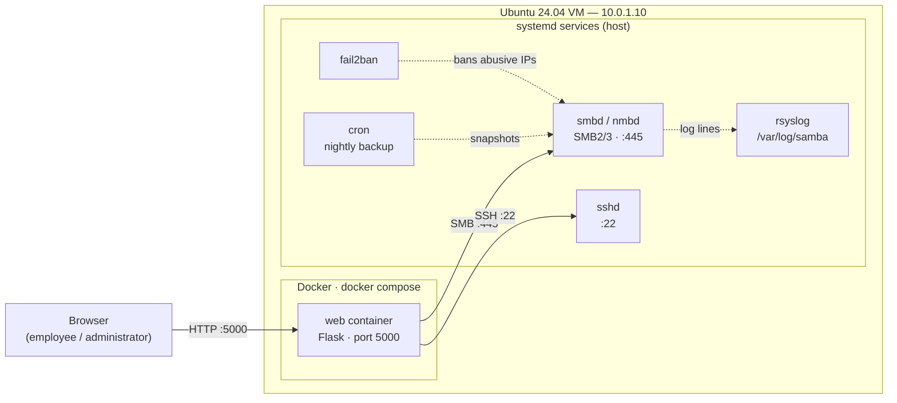
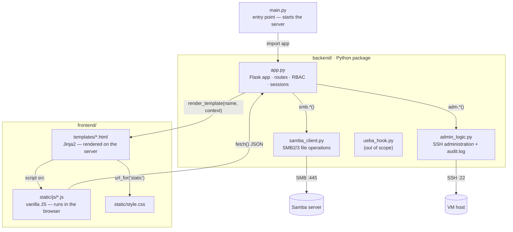
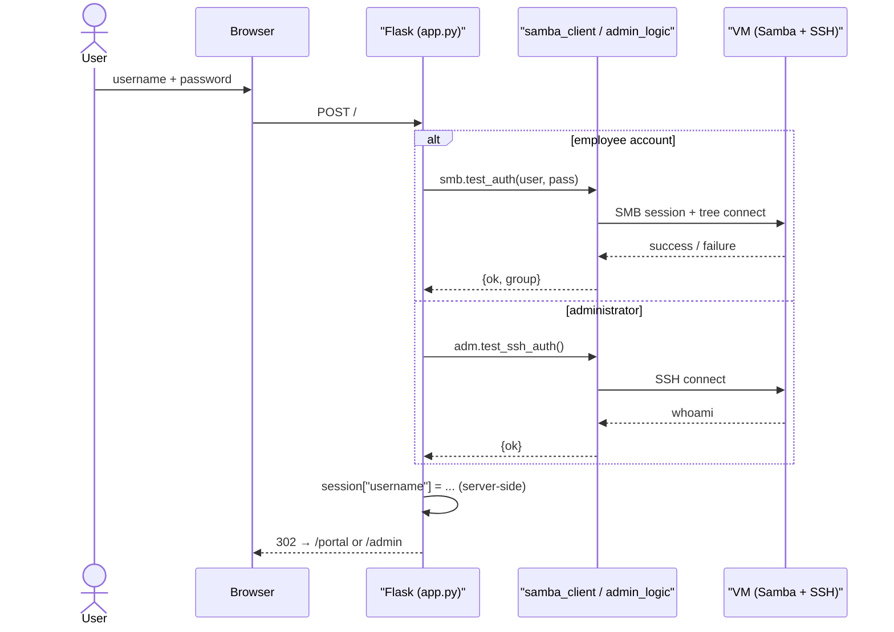
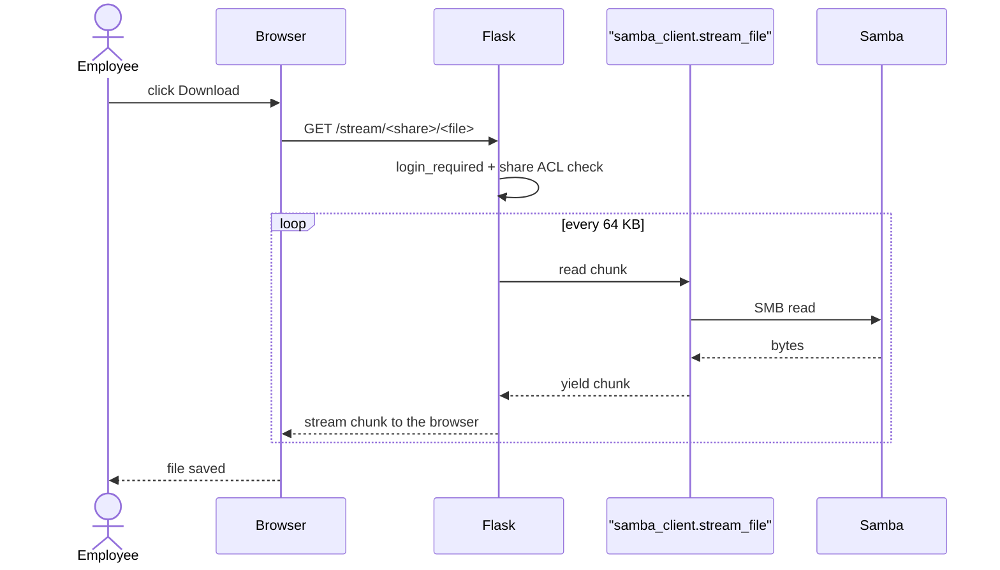

# SambaPME

**A web portal for a Samba file server.** Employees sign in and browse the shared
folders of their department; administrators get a dashboard to manage Samba accounts,
watch fail2ban, run backups and audit activity — all from the browser.

> Portfolio project (application for a developer internship).
> Focus on the front-end (**HTML/CSS/JS**, with a **React** login page as a bonus),
> backed by a *real* Samba / SSH infrastructure — nothing is mocked.

---

## Context

SambaPME simulates the internal file-sharing portal of a small company (a *PME*).
A Linux server runs **Samba 4** (SMB2/3 with **encryption required**) and exposes one
share per department (`direction`, `comptabilite`, `rh`, `technique`) plus a shared one
(`commun`). The portal lets employees **list, upload, download, preview and delete**
files, and gives IT a dashboard that drives the **real server over SSH**
(`smbstatus`, `pdbedit`, `fail2ban-client`, `systemctl`, the backup script…).

The infrastructure is deliberate and realistic:

- **Samba, fail2ban, backups and logs run as systemd services on the VM** — the real server.
- **Only the web app is containerized** (Docker); it reaches Samba over **SMB** and the
  host over **SSH**.

> Why this split, and how everything fits together? See **[`exp.md`](./exp.md)** for a
> detailed walk-through of the design decisions.

## Architecture



**Communication, in three flows:**

| Flow | Path | What happens |
|------|------|--------------|
| **Employee** | browser → `web:5000` → SMB `10.0.1.10:445` | Login is validated against Samba; list / upload / download / preview / delete are SMB operations on the department share. |
| **Administrator** | browser → `web:5000` → SSH `10.0.1.10:22` | The dashboard runs real commands on the host and renders their output. |
| **Security** | fail2ban ⟷ Samba logs | fail2ban bans abusive IPs at the OS level; the dashboard reads the ban list and can unban an address. |

Inside a container, `127.0.0.1` is the *container itself* — that is why the portal targets
the VM's IP (`10.0.1.10`) for both SMB and SSH.

## How the code files work together



| File | Responsibility |
|------|----------------|
| `main.py` | Boots the web server (`app.run(...)`). |
| `backend/app.py` | The Flask app: URL routes, authentication, RBAC, sessions, error handlers. Passes data to Jinja templates. |
| `backend/samba_client.py` | Everything SMB: list, upload, stream (chunked), preview, delete, password check. |
| `backend/admin_logic.py` | Everything SSH: service status, Samba users, fail2ban, backups — plus the local `audit.log`. |
| `frontend/templates/*.html` | **Jinja2** pages, rendered by Flask before being sent to the browser. |
| `frontend/static/js/*.js` | Browser-side behaviour (theme, modals, live polling) — plain JavaScript. |
| `frontend/static/style.css` | All styling, with CSS variables for dark/light themes. |

## Request lifecycle

**Sign-in** (employee via SMB, administrator via SSH):



**Download** (streamed in 64 KB chunks — constant memory):



## Tech stack

| Layer | Technology |
|-------|------------|
| Web backend | Python · **Flask** · Flask-Session (server-side filesystem sessions) |
| File access | **smbprotocol** (SMB2/3, encryption required) |
| Server administration | **Paramiko** (SSH) → `systemctl`, `smbstatus`, `pdbedit`, `fail2ban-client`… |
| Frontend | **Jinja2** templates · vanilla **JavaScript** · hand-written **CSS** · **React** (Vite) login page *(bonus)* |
| Virtualization | **Vagrant** + libvirt · Ubuntu 24.04 |
| Server services | **Samba 4** (smbd/nmbd) · fail2ban · rsyslog · cron · sshd — all **systemd** |
| Packaging | **Docker** + Docker Compose (web only) · **uv** for Python dependencies |
| Host tooling | **Makefile** + bash scripts (Fedora host) |

## Repository layout

```
backend/            Flask application
  app.py              routes, RBAC, sessions, error handlers
  samba_client.py     SMB operations (list, upload, stream, preview, delete)
  admin_logic.py      SSH/Paramiko administration + audit log
  ueba_hook.py        UEBA pipeline (out of scope, not wired in)
frontend/           Jinja templates + static assets (css / js)
infra/              Vagrantfile (VM + Docker) and setup_samba.sh (provisions Samba)
Dockerfile          builds the web image
docker-compose.yml  single `web` service
main.py             entry point (Flask, port 5000)
Makefile, tools.sh  host tooling (provision libvirt/vagrant/uv)
pyproject.toml, uv.lock   Python dependencies
exp.md              design rationale & explanations
roadmap.md          working plan / status
```

## Quickstart

> Everything runs from the **host**. `tools.sh` and `setup_samba.sh` are host-side scripts.

**Prerequisites:** a host with libvirt + Vagrant + uv (`make tools` installs them on Fedora).

```bash
make tools      # 1. install host tooling (libvirt, Vagrant, uv)
make machine    # 2. boot the VM (10.0.1.10) with Docker inside
make infra      # 3. provision Samba + fail2ban + backups on the VM
make env        # 4. create .env from .env.example
make up         # 5. build & start the web container on the VM
# → open http://10.0.1.10:5000
```

| Target | Runs on | Purpose |
|--------|---------|---------|
| `make help` | host | List every target. |
| `make tools` | host | Install libvirt, Vagrant, uv. |
| `make machine` | host | `vagrant up` — create the VM and install Docker. |
| `make infra` | host | `setup_samba.sh` — configure Samba on the VM (over SSH). |
| `make env` | host | Create `.env` from `.env.example`. |
| `make up` / `down` / `logs` | host → VM | Drive the `web` container. |
| `make ssh` | host | Shell into the VM. |
| `make destroy` | host | Delete the VM. |

**Without Vagrant** (any Ubuntu server): copy the repo over, run `./infra/setup_samba.sh`
on the host, then `cp .env.example .env && docker compose up -d --build`.

All configuration lives in `.env` (see `.env.example`): VM IP, Samba server, SSH
credentials, Flask secret key.

## Demo accounts

| Role | Username | Password |
|------|----------|----------|
| Direction | `direction1` · `direction2` | `Samba2026!` |
| Accounting | `compta1` · `compta2` | `Samba2026!` |
| Human Resources | `rh1` · `rh2` | `Samba2026!` |
| Technical | `tech1` · `tech2` | `Samba2026!` |
| Administrator | `admin` | *authenticated against the VM over SSH (credentials from `.env`)* |

Employees only see the shares allowed to their group, plus the shared `commun` space.

## Security highlights

- **SMBv1 disabled**, SMB2 minimum, **SMB3 encryption required** (`smb encrypt = required`).
- **fail2ban** watches the Samba logs and bans brute-force IPs — active on the host, not simulated.
- Every external value is passed through **`shlex.quote()`** before reaching a shell command.
- **Server-side sessions**, signed, with a configurable secret key.
- An **audit log** records administrative actions.
- Nightly **backups** to `/srv/backup` (full on Sunday, incremental otherwise).

## Design decisions (short version)

| Decision | Why | Alternative considered |
|----------|-----|------------------------|
| Samba stays **systemd**, not containerized | Real fail2ban, real services, real IPs — the security thread is genuine | Samba in a container (loses the realism) |
| Only the **web** is dockerized | Reproducible, portable app layer | Everything bare-metal |
| Container → **VM IP**, not `127.0.0.1` | Inside a container, loopback is the container | `network_mode: host` (less portable) |
| **No gunicorn/nginx** (demo) | Keep the footprint minimal | gunicorn + nginx (documented as a prod upgrade) |
| **Server-rendered** pages (Jinja) + light JS | Simple, SEO/robust, no build step | Full SPA |
| **React** only for login (bonus) | Showcase front-end skills without rewriting everything | Migrate the whole UI |

The full reasoning is in **[`exp.md`](./exp.md)**.

## Production notes

- For the demo the web app is served by the **built-in Flask server** (with threading).
  A production deployment would sit behind a reverse proxy (e.g. nginx) — mind the
  `client_max_body_size` limit (default 1 MB vs. uploads up to 500 MB here).
- Uploads are currently read fully into memory (bounded by `MAX_CONTENT_LENGTH`, 500 MB);
  a streaming upload path would be the next step.
- TLS termination, `hosts allow` hardening, and CI are on the roadmap.

## Screenshots

*(to be added — login dark/light, portal file list, admin dashboard: overview, users, fail2ban)*

## Status & roadmap

See **[`roadmap.md`](./roadmap.md)** for the detailed, file-by-file plan and current progress.
