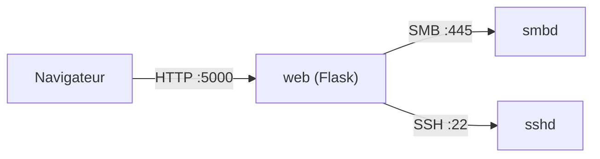

# exp.md - Explications & justifications de conception

<div align='center'>
<a href="./exp.md">Read the English version</a>
</div>

> Ce document répond à une question simple : **« pourquoi c'est fait comme ça ? »**.
> Il complète le [`README.fr.md`](./README.fr.md) (qui décrit *quoi*) et les notes de
> conception disséminées dans le code.
>
> Il est écrit pour que tu puisses **expliquer chaque choix en entretien** - y compris
> ceux qu'on ne pense pas à faire « sur le moment ».

---

## Sommaire

- [1. Le modèle mental en une phrase](#1-le-modèle-mental-en-une-phrase)
- [2. Qui parle à qui (et pourquoi l'IP et pas `localhost`)](#2-qui-parle-à-qui-et-pourquoi-lip-et-pas-localhost)
- [3. Comment le code est découpé](#3-comment-le-code-est-découpé)
- [4. Flask en 30 secondes](#4-flask-en-30-secondes)
- [5. Jinja2 : « du Python dans du HTML » (la partie que tu voulais creuser)](#5-jinja2---du-python-dans-du-html--la-partie-que-tu-voulais-creuser)
- [6. La couche SMB (`samba_client.py`)](#6-la-couche-smb-samba_clientpy)
- [7. La couche admin (`admin_logic.py`)](#7-la-couche-admin-admin_logicpy)
- [8. Sessions & authentification](#8-sessions--authentification)
- [9. Posture sécurité (le « fil rouge »)](#9-posture-sécurité-le--fil-rouge-)
- [10. Empaquetage & exécution (Docker, uv)](#10-empaquetage--exécution-docker-uv)
- [11. L'infra : qu'est-ce qui tourne où ? (le point qui prête à confusion)](#11-linfra--quest-ce-qui-tourne-où--le-point-qui-prête-à-confusion)
- [12. Décisions & compromis (tableau récapitulatif)](#12-décisions--compromis-tableau-récapitulatif)
- [13. « Est-ce que j'y aurais pensé tout seul ? » - les réflexes à garder](#13--est-ce-que-jy-aurais-pensé-tout-seul-----les-réflexes-à-garder)
- [14. Glossaire](#14-glossaire)

---

## 1. Le modèle mental en une phrase

> Un navigateur parle à **une petite appli web (Flask)** qui, elle, ne stocke
> **rien** : elle se contente de **relayer** vers **Samba** (pour les fichiers) et
> vers **le serveur SSH de la VM** (pour l'administration).

Autrement dit : le portail est un **proxy intelligent et sécurisé** au-dessus d'une
infra Linux existante. C'est pour ça qu'une grande partie du code ressemble à
« je traduis un clic de l'utilisateur en une opération SMB ou une commande SSH ».

---

## 2. Qui parle à qui (et pourquoi l'IP et pas `localhost`)



Le piège classique : dans un **conteneur**, `127.0.0.1` désigne **le conteneur lui-même**,
pas la VM. Comme Samba et SSH tournent sur **l'hôte** (la VM), le conteneur doit viser
**l'IP de la VM** (`10.0.1.10`). D'où `SAMBA_SERVER` et `SSH_HOST` dans `.env`.
*(L'alternative `network_mode: host` fonctionnerait aussi, mais rend le compose moins
portable.)*

---

## 3. Comment le code est découpé

```
main.py                  → point d'entrée : démarre le serveur
backend/ (le package)
  └─ app.py              → les routes web (le « contrôleur »)
  └─ samba_client.py     → tout ce qui touche aux fichiers en SMB
  └─ admin_logic.py      → tout ce qui touche à l'admin en SSH
  └─ ueba_hook.py        → hors périmètre (non branché)
frontend/
  └─ templates/*.html    → pages Jinja (rendues côté serveur)
  └─ static/…            → CSS + JS servis tels quels au navigateur
```

**Pourquoi un package `backend/` avec des imports relatifs ?**

```python
from . import samba_client as smb
from . import admin_logic  as adm
```

- **Séparation des responsabilités** : `app.py` ne sait pas *comment* on parle SMB ; il
  appelle `smb.list_files(...)`. Si la lib SMB change demain, un seul fichier bouge.
- Les imports relatifs (`from . import`) signalent que ces fichiers forment **un tout
  cohérent** (le package `backend`), pas des scripts isolés.

**Le piège `template_folder` / `static_folder` :**

```python
app = Flask(__name__,
            template_folder="../frontend/templates",
            static_folder="../frontend/static")
```

Flask résout ces chemins **relativement à `app.py`** (donc à `backend/`). Comme les
templates sont dans `frontend/`, on remonte d'un cran (`../frontend/...`). Sans ça :
erreur *« TemplateNotFound »*, ou fichiers statiques introuvables. C'est le genre de bug
qu'on ne voit qu'à l'exécution - d'où l'intérêt de démarrer l'appli tôt.

**Pourquoi un `main.py` séparé ?** Pour que le package reste **importable** (utile pour
les tests, pour `gunicorn`, pour un futur `flask run`) sans démarrer le serveur à
l'import. `main.py` ne lance le serveur que sous `if __name__ == "__main__":`.

---

## 4. Flask en 30 secondes

Flask est un micro-framework : on associe une **URL** à une **fonction**.

```python
@app.route("/portal")
@login_required
def portal():
    ...
    return render_template("portal.html", username=session["username"], ...)
```

- `@app.route(...)` : un **décorateur** qui enregistre la fonction comme gestionnaire de
  cette URL.
- Une **vue** (ici `portal`) reçoit la requête, lit `request`, prépare les données, puis
  **renvoie une réponse** (HTML via `render_template`, une redirection, ou du JSON via
  `jsonify`).
- `@login_required` / `@admin_required` sont des décorateurs maison : ils **enveloppent**
  la vue pour vérifier la session avant de l'exécuter.

**Cycle de vie d'une requête :**

```
Navigateur → Flask (route) → vue Python → (SMB / SSH) → render_template → HTML → Navigateur
```

---

## 5. Jinja2 : « du Python dans du HTML » (la partie que tu voulais creuser)

### 5.1 Le principe

Flask **ne sert pas** de fichiers `.html` statiques. Il **fabrique** le HTML à chaque
requête : un **moteur de template** (Jinja2) prend un fichier `.html` contenant des
**trous** et les remplit avec des données Python.

```python
return render_template("portal.html",
    username = session["username"],
    group    = group,
    files    = files_data,          # une liste de dicts
    group_meta = GROUP_META,        # un dict de dicts
    server_ip  = os.getenv("SAMBA_SERVER"))
```

Les arguments après le nom du template forment le **contexte** : les variables que le
HTML a le droit d'utiliser. C'est le **seul** pont entre Python et le HTML.

### 5.2 Les trois syntaxes Jinja

| Syntaxe | Rôle | Exemple |
|---------|------|---------|
| `{{ ... }}` | **Afficher** une valeur | `{{ username }}` |
| `` | **Logique** (if, for, set) | ` … ` |
| `{# ... #}` | **Commentaire** (absent du HTML final) | `{# note interne #}` |

### 5.3 Concrètement, dans `portal.html`

```jinja
{# Boucle sur les partages autorisés de l'utilisateur #}

  
  <a href="{{ url_for('portal', share=s) }}"
     class="sidebar-item active">
    {{ m.icon }} {{ m.label }}
  </a>

```

Trois choses à retenir :

1. `` = une boucle Python, mais écrite en HTML.
2. `group_meta[s].icon` : Jinja cherche la clé `s` dans le dict, puis la clé `icon`. **En
   Jinja, le point `.` fait à la fois `getattr` et `["clé"]`** - donc `m.icon` marche sur
   un dict, comme `m.color`.
3. `active` = une classe CSS conditionnelle.

Et pour la liste de fichiers :

```jinja

  <div class="error-box"><p>{{ smb_error }}</p></div>

  <div class="empty-folder">Empty folder</div>

  
    <tr>
      <td>{{ f.name }}</td>
      <td>{{ f.size }}</td>
      <td>{{ f.date }}</td>
    </tr>
  

```

> C'est **le serveur** qui décide quoi montrer (erreur / vide / liste). Le navigateur
> reçoit du HTML **déjà rempli**.

### 5.4 `url_for` : le routage « à l'envers »

```jinja
<a href="{{ url_for('logout') }}">Sign out</a>
<form method="POST" action="{{ url_for('upload', share=share) }}">
<link rel="stylesheet" href="{{ url_for('static', filename='style.css') }}">
```

**Pourquoi ne pas écrire `/logout` en dur ?** Parce que `url_for` **génère** l'URL à
partir du *nom de la fonction Python* (`logout`, `upload`, `portal`…). Si l'URL passe de
`/logout` à `/sign-out` demain, **rien ne change dans le HTML**. C'est aussi ce qui
relie les fichiers statiques (`url_for('static', ...)` → `/static/...`).

### 5.5 Les messages « flash »

```python
flash("✅ Password changed successfully.", "success")
```

Le message est stocké dans la session pour **une** requête suivante, puis affiché :

```jinja

  
    <div class="flash flash-{{ cat }}">{{ msg }}</div>
  

```

Le motif classique **POST → redirect → GET** : après une action, on **redirige** (ici vers
`portal`), et le message survit au rechargement. Ça évite qu'un F5 rejoue l'action. Côté
client, `common.js` ajoute un bouton de fermeture et fait disparaître chaque message
automatiquement après quelques secondes.

### 5.6 Sécurité : échappement automatique (XSS)

Jinja **échappe par défaut** ce qu'il affiche dans `{{ }}` :

```jinja
{{ filename }}   {# <script> devient &lt;script&gt; #}
```

Donc un nom de fichier malveillant ne peut pas injecter de HTML/JS.
⚠️ Exception : `{{ value | safe }}` **désactive** l'échappement - à n'utiliser que sur des
données 100 % fiables.

### 5.7 Serveur vs navigateur : qui fait quoi ?

| Côté serveur (Jinja/Python) | Côté navigateur (JS) |
|-----------------------------|----------------------|
| Génère la page, les listes, les conditions | Interactivité **sans recharger** |
| `render_template(...)` | `toggleTheme()`, `openModal()` |
| Décide erreur / vide / contenu | `fetch()` vers `/admin/refresh` (polling 30 s) |

Il n'y a **pas d'héritage de template** ici (``, ``) : chaque page
est autonome. C'est un choix de simplicité ; avec plus de pages, on factoriserait un
`base.html`.

---

## 6. La couche SMB (`samba_client.py`)

### 6.1 Pourquoi `smbprotocol` directement ?

On ne **monte pas** le partage Samba dans le conteneur (`mount -t cifs`). On parle SMB
**depuis le code**. Raisons : pas besoin de privilèges/montages côté hôte, ça marche
partout où ça tourne, et surtout ça permet d'**authentifier chaque utilisateur du portail
avec ses propres identifiants Samba** (pas de compte de service unique).

### 6.2 Le chiffrement

```python
session = Session(conn, username, password, require_encryption=True)
```

Le serveur est configuré avec `smb encrypt = required` ; le client **exige** donc le
chiffrement, sinon la négociation échoue. (SMB3 chiffré = le fil rouge sécurité.)

### 6.3 Détection du groupe (astuce sans LDAP)

```python
def _detect_group(username, password):
    for group, shares in GROUP_SHARES.items():
        for share in shares:
            if share == "commun": continue
            try:
                with _smb(share, username, password):
                    return group     # ça marche → c'est le groupe de l'utilisateur
            except Exception:
                continue
```

Plutôt que d'interroger un annuaire, on **teste l'accès aux partages** : le premier
partage privé accessible révèle le groupe. Le mot de passe est de toute façon validé par
la session SMB au passage.

### 6.4 Le streaming par morceaux (64 Ko)

```python
while True:
    try:
        chunk = file_open.read(offset, CHUNK_SIZE)   # 64 Ko
    except EndOfFile:
        break
    if not chunk: break
    yield chunk                                      # un générateur !
```

Un **générateur** Python : Flask envoie chaque morceau au fur et à mesure. La RAM reste à
**~64 Ko** même pour un fichier de 500 Mo. C'est aussi **pourquoi** on active
`threaded=True` dans `main.py` : pendant qu'un téléchargement « tient » une requête, les
autres ne sont pas bloquées.

> SMB lève `EndOfFile` quand on lit exactement à la fin du fichier - c'est une fin de flux
> normale, pas une erreur. La gérer évite aussi de tronquer les téléchargements plus gros
> qu'un morceau.

### 6.5 La limite d'upload assumée

```python
data = file.read()        # tout en mémoire
```

L'upload charge le fichier **entièrement en RAM** (borné par `MAX_CONTENT_LENGTH = 500 Mo`).
Acceptable pour une démo mono-utilisateur ; l'étape suivante serait de **streamer**
l'upload aussi (lecture par morceaux côté serveur + écriture SMB au fil de l'eau).

### 6.6 Les noms de fichiers sont en UTF-16LE

Piège subtil : SMB renvoie les **noms** des entrées de dossier sous forme d'**octets
UTF-16LE** bruts. Traités comme du texte, `README.md` s'affiche
`b'R\x00E\x00A\x00D\x00M\x00E\x00.\x00m\x00d\x00'`, les entrées `.`/`..` ne sont plus
filtrées, les extensions ne sont plus reconnues, et une suppression vise un chemin
corrompu. D'où `_decode_name()` (et le filtrage `.`/`..`) dans `list_files`.

---

## 7. La couche admin (`admin_logic.py`)

### 7.1 Pourquoi SSH + `paramiko` ?

Le tableau de bord doit faire des choses que **seul l'hôte** peut faire :
`systemctl status smbd`, `smbstatus`, `pdbedit`, `fail2ban-client`, lancer la sauvegarde…
Comme on ne veut pas donner à l'appli un accès direct à `/etc` ou aux sockets, on passe
par **SSH**, on exécute des **commandes**, puis on **lit la sortie** et on la transforme
en chiffres pour l'UI.

> Conséquence importante : le tableau de bord affiche de **vraies** données de la VM
> (charge, mémoire, disque, bans fail2ban), pas des données simulées.

### 7.2 L'injection de commande : `shlex.quote`

```python
def _sudo(cmd):
    pwd_safe = shlex.quote(SSH_PASSWORD)
    return f"echo {pwd_safe} | sudo -S {cmd}"
```

Toute valeur fournie de l'extérieur (nom d'utilisateur, mot de passe, IP) passe par
**`shlex.quote()`** avant d'être insérée dans une commande shell. Sans ça, un nom comme
`x; rm -rf /` serait exécuté. C'est **la** règle de sécurité numéro un quand on construit
des commandes shell en Python.

### 7.3 Le journal d'audit

```python
AUDIT_LOG = Path(os.getenv("AUDIT_LOG", Path(__file__).parent / "audit.log"))
```

Chaque action d'admin (connexion, ajout/suppression d'utilisateur, ban, sauvegarde…) est
écrite dans un fichier local avec horodatage et auteur. C'est ce qui donne la dimension
« traçabilité » (thème SOC). Dans le conteneur, ce fichier vit dans un **volume** pour
survivre aux rebuilds - et le **dossier** cible est pré-créé dans l'image
(`RUN mkdir -p /app/logs`), sinon Docker créerait un **dossier** là où on attend un
fichier (piège classique).

---

## 8. Sessions & authentification

### 8.1 Sessions **côté serveur**

```python
app.config["SESSION_TYPE"]      = "filesystem"
app.config["SESSION_FILE_DIR"]  = "/tmp/flask_sessions_samba"
app.config["SESSION_USE_SIGNER"]= True
```

Le navigateur ne reçoit qu'un **identifiant de session signé** ; les données (nom,
groupe, rôle…) restent **sur le serveur**. On ne fait pas confiance au client qui
prétendrait « je suis admin ». *(D'où le volume nommé sur `/tmp/flask_sessions_samba`,
sinon tout le monde est déconnecté à chaque rebuild.)*

### 8.2 Pourquoi on garde le mot de passe en session

Chaque opération SMB a besoin des **identifiants de l'utilisateur** (pas de compte
partagé). On les stocke donc en session **côté serveur** pour les réutiliser. C'est un
compromis assumé : le mot de passe n'est jamais exposé au navigateur, mais il est en clair
dans un fichier de session sur le serveur. Une évolution serait un coffre chiffré ou un
mécanisme de ticket SMB.

### 8.3 Décorateurs et RBAC

```python
def login_required(f):          # exige session["username"]
def admin_required(f):          # exige session["role"] == "admin"
```

Le contrôle d'accès aux partages est centralisé :

```python
GROUP_ACCESS = {"direction": ["direction", "commun"], ...}
```

Une vue vérifie toujours `if share not in GROUP_ACCESS[session["group"]]: ...`. On
n'accorde **jamais** un partage juste parce que l'URL le demande.

### 8.4 Une bizarrerie à connaître

Le login admin appelle `adm.test_ssh_auth()`, qui **utilise les identifiants SSH de
`.env`** (donc le champ « mot de passe » saisi est **ignoré** pour l'admin). À corriger ou
à documenter - mais il faut le savoir pour ne pas être surpris en démo.

---

## 9. Posture sécurité (le « fil rouge »)

| Mesure | Où | Pourquoi |
|--------|----|----------|
| SMBv1 désactivé, SMB2 minimum | `smb.conf` | SMBv1 est obsolète et vulnérable (WannaCry). |
| `smb encrypt = required` | `smb.conf` + `require_encryption=True` | Trafic SMB chiffré de bout en bout. |
| fail2ban | systemd de l'hôte | Bans réels d'IP en brute-force. |
| `shlex.quote` | `admin_logic.py` | Protection contre l'injection de commande. |
| Échappement Jinja | templates | Anti-XSS. |
| Sessions signées et côté serveur | Flask-Session | Le client ne peut pas forger son rôle. |
| `MAX_CONTENT_LENGTH` | `app.py` | Borne les uploads. |
| `audit.log` | `admin_logic.py` | Traçabilité des actions. |
| Groupes Unix + masques `2770/2777` | `setup_samba.sh` | Compartimentage des partages. |

---

## 10. Empaquetage & exécution (Docker, uv)

**Pourquoi dockeriser seulement le web ?** Parce que le but est de montrer un serveur
Linux **réel** : si Samba était dans un conteneur, fail2ban/systemd/les partages ne
seraient plus « réels ». On conteneurise donc uniquement la partie applicative
(reproductible, portable) et on garde l'infra en **systemd**.

**Le Dockerfile**

```dockerfile
FROM python:3.14-slim
WORKDIR /app
COPY --from=ghcr.io/astral-sh/uv:latest /uv /uvx /bin/
COPY pyproject.toml uv.lock ./
RUN uv sync --frozen --no-dev --no-install-project
COPY backend/ /app/backend/
COPY frontend/ /app/frontend/
COPY main.py .
RUN mkdir -p /app/logs
CMD ["/app/.venv/bin/python", "main.py"]
```

- **`uv` + `uv.lock`** = dépendances **gelées** → build reproductible.
- **`CMD` avec le python du venv** directement : on évite que `uv run` resynchronise au
  démarrage du conteneur (moins de surcoût, moins de surprises de permissions).
- **`mkdir -p /app/logs`** : comme expliqué en §7.3, le point de montage doit être un
  **dossier** dans l'image, sinon le volume nommé attaché dessus se comporte comme un
  dossier et le fichier d'audit ne peut jamais être créé.

**Le compose**

```yaml
services:
  web:
    build: .
    ports: ["5000:5000"]
    env_file: [.env]
    environment:
      SAMBA_SERVER: ${VM_IP:-10.0.1.10}
      SSH_HOST:     ${VM_IP:-10.0.1.10}
      AUDIT_LOG:    /app/logs/audit.log
    volumes:
      - admin-audit:/app/logs
      - sessions:/tmp/flask_sessions_samba
    healthcheck:
      test: ["CMD", "python", "-c", "import urllib.request; urllib.request.urlopen('http://localhost:5000/health')"]
```

- **`env_file`** : sinon l'admin ne reçoit jamais `SSH_USER`/`SSH_PASSWORD`.
- **volumes** : persistance des sessions (sinon déconnexion à chaque rebuild) et du
  journal d'audit.
- **`healthcheck`** : `docker compose` peut dire si le conteneur est **sain**, via une
  route `/health` dédiée (renvoie `{"status":"ok"}`).

**Pourquoi pas gunicorn ?** Choix de **démo** : le serveur intégré de Flask suffit
(mono-utilisateur) et évite une couche de plus. Pour la concurrence, `threaded=True`. En
prod → reverse proxy (nginx) + serveur WSGI.

---

## 11. L'infra : qu'est-ce qui tourne où ? (le point qui prête à confusion)

| Élément | Tourne sur | Rôle |
|---------|------------|------|
| `tools.sh` | **l'hôte (ta machine Fedora)** | Installe libvirt, Vagrant, uv. |
| `Makefile` | **l'hôte** | Orchestre tout (pilote Vagrant). |
| `Vagrantfile` | **hôte** pilote / **VM** exécute | Crée la VM 10.0.1.10 + installe Docker. |
| `infra/setup_samba.sh` | **l'hôte** (via SSH) | Configure Samba/fail2ban/backup **dans la VM**. |
| `docker compose` | **la VM** | Lance le conteneur `web`. |
| Samba, fail2ban, sshd, cron | **la VM (systemd)** | Les vrais services. |

> `tools.sh` **et** `setup_samba.sh` ne tournent **jamais** *dans* le conteneur : ce sont
des scripts sur ta machine. `setup_samba.sh` parle à la VM **en SSH** (`sshpass`) pour la
configurer à distance. `make sync` copie de même le projet dans la VM avec `rsync` via
SSH.

**Pourquoi Vagrant ?** Pour décrire l'environnement **en code** (`Vagrantfile`) : une IP
fixe connue (`10.0.1.10`), une VM jetable et reproductible. C'est la même idée que Docker,
mais au niveau serveur.

---

## 12. Décisions & compromis (tableau récapitulatif)

| Décision | Pourquoi | Alternative |
|----------|----------|-------------|
| Samba en **systemd**, pas conteneurisé | Vrais fail2ban/services/IP | Samba en conteneur (perd le réalisme) |
| Seul le **web** est dockerisé | Reproductible + portable | Tout en bare-metal |
| Le conteneur vise l'**IP de la VM** | `127.0.0.1` = le conteneur | `network_mode: host` |
| **Sessions côté serveur** | Le client n'est pas une source de vérité | Cookie signé contenant le rôle |
| **Jinja** (rendu serveur) + JS léger | Simple, robuste, pas de build | SPA complet |
| **Pas de gunicorn** (démo) | Surface plus petite | gunicorn + nginx (prod) |
| Upload **en mémoire** | Simplicité démo | Upload entièrement streamé |

---

## 13. « Est-ce que j'y aurais pensé tout seul ? » - les réflexes à garder

Ces réflexes sont **transférables** ; c'est ce qu'un recruteur veut voir :

1. **Séparer les responsabilités** (web / SMB / SSH) → code lisible, testable.
2. **Ne jamais faire confiance au client** : sessions côté serveur, contrôles d'accès
   côté serveur, échappement des sorties.
3. **Configurer par variables d'environnement** : pas d'IP/secret en dur.
4. **Prévenir l'injection** dès qu'on construit du shell (`shlex.quote`).
5. **Borner la mémoire** : streaming par générateur, `MAX_CONTENT_LENGTH`.
6. **Lier les URL par nom** (`url_for`), jamais en dur.
7. **POST → redirect → GET** pour les actions (flash).
8. **Persistence explicite** : volumes pour sessions/audit.
9. **Penser « où est-ce que ça tourne »** : hôte vs VM vs conteneur (le piège du
   loopback).
10. **Reproductibilité** : `uv.lock`, `Vagrantfile`, image Docker.
11. **Observabilité minimale** : route `/health`, `audit.log`.
12. **Traçabilité & moindre privilège** : audit, groupe docker, utilisateur non-root
    (désactivé en démo, à réactiver en prod).

> Rien de tout ça n'est « magique » : ce sont des **réflexes** qui viennent du fait de se
> demander, à chaque ligne : *« qui parle à qui, et est-ce que je fais confiance à cette
> donnée ? »*. Le fait que tu poses la question prouve déjà que tu es sur la bonne voie.

---

## 14. Glossaire

- **WSGI** : interface standard entre un serveur web Python et une appli (Flask).
- **Jinja2** : moteur de templates de Flask (`{{ }}`, ``).
- **SMB2/3** : protocole de partage de fichiers (Samba l'implémente sous Linux).
- **fail2ban** : logiciel qui bannit des IP après trop d'échecs d'authentification.
- **systemd** : gestionnaire de services Linux (`systemctl`).
- **Volume (Docker)** : stockage persistant indépendant du conteneur.
- **Healthcheck** : commande qui indique si un conteneur est « sain ».
- **libvirt** : couche de virtualisation qu'utilise Vagrant sous Linux.
