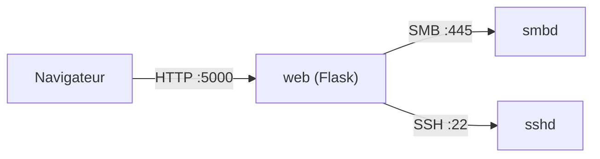

# exp.md — Explications & justifications de conception

> Ce document répond à une question simple : **« pourquoi c'est fait comme ça ? »**.
> Il complète le [`README.md`](./README.md) (qui décrit *quoi*) et la
> [`roadmap.md`](./roadmap.md) (qui décrit *l'avancement*).
>
> Il est écrit pour que tu puisses **expliquer chaque choix en entretien** —
> y compris ceux qu'on ne pense pas à faire « sur le moment ».

---

## 1. Le modèle mental en une phrase

> Un navigateur parle à **une petite appli web (Flask)** qui, elle, ne stocke
> **rien** : elle se contente de **relayer** vers **Samba** (pour les fichiers) et
> vers **le serveur SSH de la VM** (pour l'administration).

Autrement dit : le portail est un **proxy intelligent et sécurisé** au-dessus d'une
infra Linux existante. C'est pour ça qu'une grande partie du code ressemble à
« je traduis un clic de l'utilisateur en une opération SMB ou une commande SSH ».

---

## 2. Qui parle à qui (et pourquoi l'IP et pas `localhost`)



Le piège classique : dans un **conteneur**, `127.0.0.1` désigne **le conteneur
lui-même**, pas la VM. Comme Samba et SSH tournent sur **l'hôte** (la VM), le
conteneur doit viser **l'IP de la VM** (`10.0.1.10`). D'où `SAMBA_SERVER` et
`SSH_HOST` dans `.env`. *(L'alternative `network_mode: host` aurait aussi marché
mais rend le compose moins portable.)*

---

## 3. Le découpage du code

```
main.py                  → point d'entrée : démarre le serveur
backend/ (le package)
  └─ app.py              → les routes web (le « contrôleur »)
  └─ samba_client.py     → tout ce qui touche aux fichiers via SMB
  └─ admin_logic.py      → tout ce qui touche à l'admin via SSH
  └─ ueba_hook.py        → hors périmètre (non branché)
frontend/
  └─ templates/*.html    → pages Jinja (rendues côté serveur)
  └─ static/…            → CSS + JS servis tels quels au navigateur
```

**Pourquoi un package `backend/` avec imports relatifs ?**

```python
from . import samba_client as smb
from . import admin_logic  as adm
```

- **Séparation des responsabilités** : `app.py` ne sait pas *comment* on parle SMB ;
  il appelle `smb.list_files(...)`. Si demain on change de librairie SMB, un seul
  fichier bouge.
- Les imports relatifs (`from . import`) indiquent que ces fichiers forment **un
  paquet cohérent** (`backend`), pas des scripts isolés.

**Le piège `template_folder` / `static_folder` :**

```python
app = Flask(__name__,
            template_folder="../frontend/templates",
            static_folder="../frontend/static")
```

Flask résout ces chemins **relativement au fichier `app.py`** (donc à
`backend/`). Comme les templates sont dans `frontend/`, on remonte d'un cran
(`../frontend/...`). Sans ça : erreur *« TemplateNotFound »* ou fichiers statiques
introuvables. C'est le genre de bug qu'on ne voit qu'à l'exécution — d'où l'intérêt
de démarrer l'app tôt.

**Pourquoi `main.py` séparé ?** Pour que le package reste **importable** (utile pour
les tests, pour `gunicorn`, pour un futur `flask run`) sans lancer le serveur à
l'import. `main.py` ne démarre le serveur que sous `if __name__ == "__main__":`.

---

## 4. Flask en 30 secondes

Flask est un micro-framework : on associe une **URL** à une **fonction**.

```python
@app.route("/portal")
@login_required
def portal():
    ...
    return render_template("portal.html", username=session["username"], ...)
```

- `@app.route(...)` : **décorateur** qui enregistre la fonction comme gestionnaire
  de cette URL.
- Une **vue** (ici `portal`) reçoit la requête, lit `request`, prépare des données,
  puis **retourne une réponse** (du HTML via `render_template`, une redirection, ou
  du JSON via `jsonify`).
- `@login_required` / `@admin_required` sont des décorateurs maison : ils
  **enveloppent** la vue pour vérifier la session avant de l'exécuter.

**Cycle d'une requête :**

```
Navigateur → Flask (route) → vue Python → (SMB / SSH) → render_template → HTML → Navigateur
```

---

## 5. Jinja2 : « du Python dans le HTML » (la partie que tu voulais creuser)

### 5.1 Le principe

Flask **ne sert pas** des `.html` statiques. Il **fabrique** le HTML à chaque
requête : un **moteur de template** (Jinja2) prend un fichier `.html` contenant des
**trous** et les remplit avec des données Python.

```python
return render_template("portal.html",
    username = session["username"],
    group    = group,
    files    = files_data,          # une liste de dicts
    group_meta = GROUP_META,        # un dict de dicts
    server_ip  = os.getenv("SAMBA_SERVER"))
```

Les arguments après le nom du template forment le **contexte** : les variables que
le HTML pourra utiliser. C'est le **seul** pont entre Python et le HTML.

### 5.2 Les trois syntaxes Jinja

| Syntaxe | Rôle | Exemple |
|---------|------|---------|
| `{{ ... }}` | **Afficher** une valeur | `{{ username }}` |
| `` | **Logique** (if, for, set) | ` … ` |
| `{# ... #}` | **Commentaire** (absent du HTML final) | `{# note interne #}` |

### 5.3 Concrètement, dans `portal.html`

```jinja
{# Boucle sur les partages autorisés de l'utilisateur #}

  
  <a href="{{ url_for('portal', share=s) }}"
     class="sidebar-item active">
    {{ m.icon }} {{ m.label }}
  </a>

```

Trois choses à retenir :

1. `` = une boucle Python, mais écrite en HTML.
2. `group_meta[s].icon` : Jinja va chercher la clé `s` dans le dict, puis la clé
   `icon`. **En Jinja, le point `.` fait aussi bien `getattr` que `["clé"]`** — donc
   `m.icon` fonctionne sur un dict, et `m.color` aussi.
3. `active` = une classe CSS conditionnelle.

Et pour la liste des fichiers :

```jinja

  <div class="error-box"><p>{{ smb_error }}</p></div>

  <div class="empty-folder">Empty folder</div>

  
    <tr>
      <td>{{ f.name }}</td>
      <td>{{ f.size }}</td>
      <td>{{ f.date }}</td>
    </tr>
  

```

> C'est **le serveur** qui décide quoi afficher (erreur / vide / liste). Le
> navigateur reçoit du HTML **déjà rempli**.

### 5.4 `url_for` : le routage « à l'envers »

```jinja
<a href="{{ url_for('logout') }}">Sign out</a>
<form method="POST" action="{{ url_for('upload', share=share) }}">
<link rel="stylesheet" href="{{ url_for('static', filename='style.css') }}">
```

**Pourquoi ne pas écrire `/logout` en dur ?** Parce que `url_for` **génère** l'URL à
partir du *nom de la fonction Python* (`logout`, `upload`, `portal`…). Si demain
l'URL change de `/logout` à `/sign-out`, **rien à modifier dans le HTML**. C'est
aussi ce qui relie les fichiers statiques (`url_for('static', ...)` → `/static/...`).

### 5.5 Les messages « flash »

```python
flash("✅ Password changed successfully.", "success")
```

Le message est stocké en session pour **une seule** requête suivante, puis affiché :

```jinja

  
    <div class="flash flash-{{ cat }}">{{ msg }}</div>
  

```

Le motif classique **POST → redirect → GET** : après une action, on **redirige**
(ici vers `portal`), et le message survit le temps du rechargement. Ça évite qu'un
F5 rejoue l'action.

### 5.6 Sécurité : l'échappement automatique (XSS)

Jinja **échappe par défaut** ce qu'il affiche dans `{{ }}` :

```jinja
{{ filename }}   {# <script> devient &lt;script&gt; #}
```

Donc un nom de fichier malveillant ne peut pas injecter de HTML/JS.
⚠️ Exception : `{{ valeur | safe }}` **désactive** l'échappement — à n'utiliser que
sur des données 100 % maîtrisées.

### 5.7 Serveur vs navigateur : qui fait quoi ?

| Côté serveur (Jinja/Python) | Côté navigateur (JS) |
|------------------------------|----------------------|
| Génère la page, les listes, les conditions | Interactivité **sans recharger** |
| `render_template(...)` | `toggleTheme()`, `openModal()`, `fillLogin()` |
| Décide erreur / vide / contenu | `fetch()` vers `/admin/refresh` (polling 30 s) |

Ici, il n'y a **pas d'héritage de template** (``, ``) : chaque
page est autonome. C'est un choix de simplicité ; avec plus de pages, on factoriserait
un `base.html`.

---

## 6. La couche SMB (`samba_client.py`)

### 6.1 Pourquoi `smbprotocol` directement ?

On **ne monte pas** le partage Samba dans le conteneur (`mount -t cifs`). On parle
SMB **depuis le code**. Raisons : pas besoin de privilèges/montages sur l'hôte, ça
marche quel que soit le fuseau d'exécution, et surtout ça permet **d'authentifier
chaque utilisateur du portail avec ses propres identifiants Samba** (pas de compte
de service unique).

### 6.2 Le chiffrement

```python
session = Session(conn, username, password, require_encryption=True)
```

Le serveur est configuré en `smb encrypt = required` ; le client **exige** donc le
chiffrement, sinon la négociation échoue. (SMB3 chiffré = le fil rouge sécu.)

### 6.3 La détection de groupe (astuce sans LDAP)

```python
def _detect_group(username, password):
    for group, shares in GROUP_SHARES.items():
        for share in shares:
            if share == "commun": continue
            try:
                # on tente de se connecter au partage du groupe
                tree = TreeConnect(session, f"\\\\{SAMBA_SERVER}\\{share}")
                tree.connect()
                return group           # ça marche → c'est son groupe
            except Exception:
                continue
```

Plutôt que d'interroger un annuaire, on **teste l'accès aux partages** : le premier
partage privé accessible révèle le groupe. Le mot de passe est de toute façon validé
avant par la connexion SMB.

### 6.4 Le streaming par morceaux (64 Ko)

```python
def stream_file(...):
    while True:
        chunk = file_open.read(offset, CHUNK_SIZE)   # 64 Ko
        if not chunk: break
        yield chunk                                  # générateur !
```

Un **générateur** Python : Flask envoie chaque morceau au fur et à mesure. La RAM
utilisée reste **~64 Ko** même pour un fichier de 500 Mo. C'est aussi **pour ça**
qu'on active `threaded=True` dans `main.py` : pendant qu'un téléchargement « tient »
une requête, les autres ne sont pas bloquées.

### 6.5 La limite assumée de l'upload

```python
data = file.read()        # tout en mémoire
```

L'upload charge le fichier **entier en RAM** (borné par `MAX_CONTENT_LENGTH = 500 Mo`).
Acceptable pour une démo mono-utilisateur ; l'étape suivante serait de **streamer**
l'upload aussi (lecture par morceaux côté serveur + écriture SMB au fil de l'eau).

---

## 7. La couche admin (`admin_logic.py`)

### 7.1 Pourquoi SSH + `paramiko` ?

Le tableau de bord doit faire des choses que **seul l'hôte** peut faire :
`systemctl status smbd`, `smbstatus`, `pdbedit`, `fail2ban-client`, lancer le
backup… Comme on ne veut pas donner à l'appli un accès direct à `/etc` ou aux
sockets, on passe par **SSH** et on exécute des **commandes**, puis on **lit la
sortie** et on la transforme en chiffres pour l'UI.

> Conséquence importante : le tableau de bord affiche de **vraies** données de la
> VM (charge, mémoire, disque, bans fail2ban), pas des données simulées.

### 7.2 Injection de commande : `shlex.quote`

```python
def _sudo(cmd):
    pwd_safe = shlex.quote(SSH_PASSWORD)
    return f"echo {pwd_safe} | sudo -S {cmd}"
```

Toute valeur qui vient de l'extérieur (nom d'utilisateur, mot de passe, IP) est
passée par **`shlex.quote()`** avant d'être insérée dans une commande shell. Sans
ça, un nom comme `x; rm -rf /` serait exécuté. C'est **la** règle de sécurité
numéro un quand on construit des commandes shell en Python.

### 7.3 Le journal d'audit

```python
AUDIT_LOG = Path(__file__).parent / "audit.log"
```

Chaque action d'admin (login, ajout/suppression d'utilisateur, ban, backup…) est
écrite dans un fichier local avec horodatage et auteur. C'est ce qui donne la
dimension « traçabilité » (fil rouge SOC). En conteneur, ce fichier est monté sur un
**volume** pour survivre aux rebuilds — et on le **pré-crée** dans l'image, sinon
Docker créerait un **dossier** au même chemin (piège classique).

---

## 8. Sessions & authentification

### 8.1 Sessions **côté serveur**

```python
app.config["SESSION_TYPE"]      = "filesystem"
app.config["SESSION_FILE_DIR"]  = "/tmp/flask_sessions_samba"
app.config["SESSION_USE_SIGNER"]= True
```

Le navigateur ne reçoit qu'un **identifiant de session signé** ; les données
(username, groupe, rôle…) restent **sur le serveur**. On ne fait pas confiance au
client pour dire « je suis admin ». *(D'où le volume nommé sur
`/tmp/flask_sessions_samba`, sinon tout le monde est déconnecté à chaque rebuild.)*

### 8.2 Pourquoi on garde le mot de passe en session

Chaque opération SMB nécessite **les identifiants de l'utilisateur** (pas de compte
partagé). On les stocke donc dans la session **côté serveur** pour les réutiliser.
C'est un compromis assumé : le mot de passe n'est jamais exposé au navigateur, mais
il est en clair dans un fichier de session sur le serveur. Une évolution serait un
coffre chiffré ou un mécanisme de ticket SMB.

### 8.3 Décorateurs et RBAC

```python
def login_required(f):          # exige session["username"]
def admin_required(f):          # exige session["role"] == "admin"
```

Le contrôle d'accès aux partages est centralisé :

```python
GROUP_ACCESS = {"direction": ["direction", "commun"], ...}
```

Une vue vérifie toujours `if share not in GROUP_ACCESS[session["group"]][: ...]`. On
**n'autorise jamais** un partage simplement parce que l'URL le demande.

### 8.4 Un quirk à connaître

Le login admin appelle `adm.test_ssh_auth()`, qui **utilise les identifiants SSH de
`.env`** (donc le champ « password » saisi est **ignoré** pour l'admin). À corriger
ou à documenter — mais il faut le savoir pour ne pas s'étonner en démo.

---

## 9. La posture sécurité (le « fil rouge »)

| Mesure | Où | Pourquoi |
|--------|----|----------|
| SMBv1 désactivé, SMB2 minimum | `smb.conf` | SMBv1 est obsolète et vulnérable (WannaCry). |
| `smb encrypt = required` | `smb.conf` + `require_encryption=True` | Trafic SMB chiffré de bout en bout. |
| fail2ban | systemd hôte | Bans réels des IP qui brute-forcent. |
| `shlex.quote` | `admin_logic.py` | Anti-injection de commande. |
| Échappement Jinja | templates | Anti-XSS. |
| Sessions signées, côté serveur | Flask-Session | Le client ne peut pas falsifier son rôle. |
| `MAX_CONTENT_LENGTH` | `app.py` | Borner les uploads. |
| `audit.log` | `admin_logic.py` | Traçabilité des actions. |
| Groupes Unix + masques `2770/2777` | `setup_samba.sh` | Cloisonnement des partages. |

---

## 10. Emballage & exécution (Docker, uv)

**Pourquoi ne dockeriser que le web ?** Parce que le but est de montrer un **vrai**
serveur Linux : si Samba était dans un conteneur, fail2ban/systemd/les partages ne
seraient plus « réels ». On containerise donc seulement la partie applicative
(reproductible, portable), et on laisse l'infra en **systemd**.

**Le Dockerfile**

```dockerfile
FROM python:3.14-slim
COPY --from=ghcr.io/astral-sh/uv:latest /uv /uvx /bin/
COPY pyproject.toml uv.lock ./
RUN uv sync --frozen --no-dev --no-install-project
COPY backend/ frontend/ main.py ./
RUN touch /app/backend/audit.log
CMD ["/app/.venv/bin/python", "main.py"]
```

- **`uv` + `uv.lock`** = dépendances **figées** → build reproductible.
- **`CMD` avec le python du venv** directement : on évite que `uv run` re-synchronise
  au démarrage du conteneur (moins d'overhead, moins de surprises de permissions).
- **`touch audit.log`** : comme expliqué au §7.3, il **faut** que le fichier existe
  dans l'image, sinon le volume monté dessus devient un **dossier**.

**Le compose**

```yaml
services:
  web:
    build: .
    ports: ["5000:5000"]
    env_file: [.env]
    environment:
      SAMBA_SERVER: ${VM_IP:-10.0.1.10}
      SSH_HOST:     ${VM_IP:-10.0.1.10}
    volumes:
      - admin-audit:/app/backend/audit.log
      - sessions:/tmp/flask_sessions_samba
    healthcheck:
      test: ["CMD", "python", "-c", "import urllib.request; urllib.request.urlopen('http://localhost:5000/health')"]
```

- **`env_file`** : sinon l'admin ne reçoit jamais `SSH_USER`/`SSH_PASSWORD`.
- **volumes** : persistance des sessions (sinon déconnexion à chaque rebuild) et de
  l'audit.
- **`healthcheck`** : `docker compose` peut dire si le conteneur est **sain**, via une
  route `/health` dédiée (renvoie `{"status":"ok"}`).

**Pourquoi pas de gunicorn ?** Choix **démo** : le serveur intégré de Flask suffit
(mono-utilisateur) et évite une couche en plus. Pour la concurrence, `threaded=True`.
En prod → reverse proxy (nginx) + serveur WSGI.

---

## 11. L'infra : qui tourne où ? (le point qui prête à confusion)

| Élément | S'exécute sur | Rôle |
|---------|---------------|------|
| `tools.sh` | **l'hôte (ta machine, Fedora)** | Installe libvirt, Vagrant, uv. |
| `Makefile` | **l'hôte** | Orchestre tout (pilotage de Vagrant). |
| `Vagrantfile` | **l'hôte** pilote / **la VM** exécute | Crée la VM 10.0.1.10 + installe Docker. |
| `infra/setup_samba.sh` | **l'hôte** (via SSH) | Configure Samba/fail2ban/backup **dans la VM**. |
| `docker compose` | **la VM** | Lance le conteneur `web`. |
| Samba, fail2ban, sshd, cron | **la VM (systemd)** | Les vrais services. |

> `tools.sh` **et** `setup_samba.sh` ne tournent **jamais** *dans* le conteneur :
> ce sont des scripts de ta machine. `setup_samba.sh` parle à la VM **par SSH**
> (`sshpass`) pour la configurer à distance.

**Pourquoi Vagrant ?** Pour décrire l'environnement **en code** (`Vagrantfile`) :
une IP fixe connue (`10.0.1.10`), une VM jetable et reproductible. C'est la même
logique que Docker, mais au niveau serveur.

---

## 12. Décisions & compromis (tableau récapitulatif)

| Décision | Pourquoi | Alternative |
|----------|----------|-------------|
| Samba en **systemd**, pas en conteneur | fail2ban/services/IP réels | Samba conteneurisé (perd le réalisme) |
| Seul le **web** est dockerisé | Reproductible + portable | Tout en bare-metal |
| Le conteneur vise l'**IP de la VM** | `127.0.0.1` = le conteneur | `network_mode: host` |
| **Sessions côté serveur** | Le client n'est pas une source de vérité | Cookie signé contenant le rôle |
| **Jinja** (rendu serveur) + JS léger | Simple, robuste, pas de build | SPA complet |
| **React** seulement pour le login | Montrer du front sans tout réécrire | Migration totale |
| **Pas de gunicorn** (démo) | Moins de surface | gunicorn + nginx (prod) |
| Upload **en mémoire** | Simplicité démo | Streaming complet de l'upload |

---

## 13. « Est-ce que j'y aurais pensé tout seul ? » — les réflexes à garder

Ces réflexes sont **transférables** ; ce sont eux qu'un recruteur veut voir :

1. **Séparer les responsabilités** (web / SMB / SSH) → code lisible, testable.
2. **Ne jamais faire confiance au client** : sessions côté serveur, vérif d'accès
   serveur, échappement des sorties.
3. **Configurer par variables d'environnement** : aucun IP/secrets en dur.
4. **Empêcher l'injection** dès qu'on construit du shell (`shlex.quote`).
5. **Borner la mémoire** : streaming par générateurs, `MAX_CONTENT_LENGTH`.
6. **Relier les URL par nom** (`url_for`), jamais en dur.
7. **POST → redirect → GET** pour les actions (flash).
8. **Persistance explicite** : volumes pour sessions/audit.
9. **Penser « où ça tourne »** : hôte vs VM vs conteneur (le piège du loopback).
10. **Reproductibilité** : `uv.lock`, `Vagrantfile`, image Docker.
11. **Observabilité minimale** : route `/health`, `audit.log`.
12. **Traçabilité & moindre privilège** : audit, groupe docker, utilisateur non-root
    (désactivé en démo, à réactiver en prod).

> Rien de tout ça n'est « magique » : ce sont des **réflexes** qui viennent en se
> demandant à chaque ligne : *« qui parle à qui, et est-ce que je fais confiance à
> cette donnée ? »*. Le fait de te poser la question prouve déjà que tu es sur la
> bonne voie.

---

## 14. Glossaire

- **WSGI** : interface standard entre un serveur web Python et une appli (Flask).
- **Jinja2** : moteur de templates de Flask (`{{ }}`, ``).
- **SMB2/3** : protocole de partage de fichiers (Samba l'implémente sous Linux).
- **fail2ban** : logiciel qui bannit les IP après trop d'échecs d'authentification.
- **systemd** : gestionnaire de services de Linux (`systemctl`).
- **Volume (Docker)** : stockage persistant indépendant du conteneur.
- **Healthcheck** : commande qui dit si un conteneur est « sain ».
- **libvirt** : couche de virtualisation utilisée par Vagrant sous Linux.
