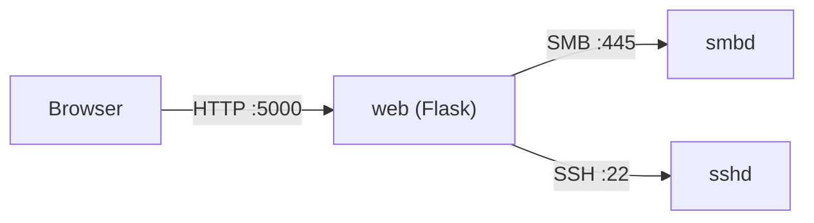

# exp.md - Explanations & design rationale

<div align='center'>
<a href="./exp.fr.md">Lire la version française</a>
</div>

> This document answers one simple question: **"why is it built this way?"**
> It complements [`README.md`](./README.md) (which describes *what*) and the design
> notes spread through the code.
>
> It is written so you can **explain every choice in an interview** - including the
> ones you don't think about "in the moment".

---

## 1. The mental model in one sentence

> A browser talks to **a small web app (Flask)** which stores **nothing** itself: it
> simply **relays** to **Samba** (for files) and to **the VM's SSH server** (for
> administration).

In other words: the portal is a **smart, secured proxy** on top of an existing Linux
infra. That is why a large part of the code looks like "I translate a user click into
an SMB operation or a shell command".

---

## 2. Who talks to whom (and why the IP and not `localhost`)



The classic trap: inside a **container**, `127.0.0.1` means **the container itself**,
not the VM. Since Samba and SSH run on **the host** (the VM), the container must target
**the VM's IP** (`10.0.1.10`). Hence `SAMBA_SERVER` and `SSH_HOST` in `.env`.
*(The `network_mode: host` alternative would also work but makes the compose file less
portable.)*

---

## 3. How the code is split

```
main.py                  → entry point: starts the server
backend/ (the package)
  └─ app.py              → the web routes (the "controller")
  └─ samba_client.py     → everything that touches files over SMB
  └─ admin_logic.py      → everything that touches admin over SSH
  └─ ueba_hook.py        → out of scope (not wired in)
frontend/
  └─ templates/*.html    → Jinja pages (rendered server-side)
  └─ static/…            → CSS + JS served as-is to the browser
```

**Why a `backend/` package with relative imports?**

```python
from . import samba_client as smb
from . import admin_logic  as adm
```

- **Separation of concerns**: `app.py` does not know *how* SMB is spoken; it calls
  `smb.list_files(...)`. If the SMB library changes tomorrow, only one file moves.
- Relative imports (`from . import`) signal that these files form **one coherent
  package** (`backend`), not isolated scripts.

**The `template_folder` / `static_folder` trap:**

```python
app = Flask(__name__,
            template_folder="../frontend/templates",
            static_folder="../frontend/static")
```

Flask resolves these paths **relative to `app.py`** (so relative to `backend/`). Since
the templates live in `frontend/`, we go up one level (`../frontend/...`). Without
this: a *"TemplateNotFound"* error, or static files that can't be found. It is the
kind of bug you only see at runtime - which is why starting the app early matters.

**Why a separate `main.py`?** So the package stays **importable** (useful for tests,
for `gunicorn`, for a future `flask run`) without starting the server on import.
`main.py` only starts the server under `if __name__ == "__main__":`.

---

## 4. Flask in 30 seconds

Flask is a micro-framework: you associate a **URL** with a **function**.

```python
@app.route("/portal")
@login_required
def portal():
    ...
    return render_template("portal.html", username=session["username"], ...)
```

- `@app.route(...)`: a **decorator** that registers the function as the handler for
  that URL.
- A **view** (here `portal`) receives the request, reads `request`, prepares data, then
  **returns a response** (HTML via `render_template`, a redirect, or JSON via
  `jsonify`).
- `@login_required` / `@admin_required` are home-made decorators: they **wrap** the view
  to check the session before running it.

**Lifecycle of a request:**

```
Browser → Flask (route) → Python view → (SMB / SSH) → render_template → HTML → Browser
```

---

## 5. Jinja2: "Python inside HTML" (the part you wanted to dig into)

### 5.1 The principle

Flask **does not serve** static `.html` files. It **builds** the HTML on every request:
a **template engine** (Jinja2) takes a `.html` file containing **holes** and fills them
with Python data.

```python
return render_template("portal.html",
    username = session["username"],
    group    = group,
    files    = files_data,          # a list of dicts
    group_meta = GROUP_META,        # a dict of dicts
    server_ip  = os.getenv("SAMBA_SERVER"))
```

The arguments after the template name form the **context**: the variables the HTML may
use. It is the **only** bridge between Python and the HTML.

### 5.2 The three Jinja syntaxes

| Syntax | Role | Example |
|--------|------|---------|
| `{{ ... }}` | **Display** a value | `{{ username }}` |
| `` | **Logic** (if, for, set) | ` … ` |
| `{# ... #}` | **Comment** (absent from the final HTML) | `{# internal note #}` |

### 5.3 Concretely, in `portal.html`

```jinja
{# Loop over the user's allowed shares #}

  
  <a href="{{ url_for('portal', share=s) }}"
     class="sidebar-item active">
    {{ m.icon }} {{ m.label }}
  </a>

```

Three things to remember:

1. `` = a Python loop, but written in HTML.
2. `group_meta[s].icon`: Jinja looks up key `s` in the dict, then key `icon`. **In
   Jinja, the dot `.` does both `getattr` and `["key"]`** - so `m.icon` works on a dict,
   and `m.color` too.
3. `active` = a conditional CSS class.

And for the file list:

```jinja

  <div class="error-box"><p>{{ smb_error }}</p></div>

  <div class="empty-folder">Empty folder</div>

  
    <tr>
      <td>{{ f.name }}</td>
      <td>{{ f.size }}</td>
      <td>{{ f.date }}</td>
    </tr>
  

```

> It is **the server** that decides what to show (error / empty / list). The browser
> receives HTML **already filled in**.

### 5.4 `url_for`: routing "in reverse"

```jinja
<a href="{{ url_for('logout') }}">Sign out</a>
<form method="POST" action="{{ url_for('upload', share=share) }}">
<link rel="stylesheet" href="{{ url_for('static', filename='style.css') }}">
```

**Why not hard-code `/logout`?** Because `url_for` **generates** the URL from the
*Python function name* (`logout`, `upload`, `portal`…). If the URL changes from
`/logout` to `/sign-out` tomorrow, **nothing changes in the HTML**. It is also what
links the static files (`url_for('static', ...)` → `/static/...`).

### 5.5 "Flash" messages

```python
flash("✅ Password changed successfully.", "success")
```

The message is stored in the session for **one** following request, then displayed:

```jinja

  
    <div class="flash flash-{{ cat }}">{{ msg }}</div>
  

```

The classic **POST → redirect → GET** pattern: after an action, we **redirect** (here to
`portal`), and the message survives the reload. This prevents an F5 from replaying the
action. On the client side, `common.js` adds a close button and auto-dismisses each
message after a few seconds.

### 5.6 Security: automatic escaping (XSS)

Jinja **escapes by default** what it prints inside `{{ }}`:

```jinja
{{ filename }}   {# <script> becomes &lt;script&gt; #}
```

So a malicious file name cannot inject HTML/JS.
⚠️ Exception: `{{ value | safe }}` **disables** escaping - only use it on 100% trusted
data.

### 5.7 Server vs browser: who does what?

| Server side (Jinja/Python) | Browser side (JS) |
|-----------------------------|-------------------|
| Generates the page, lists, conditions | Interactivity **without reloading** |
| `render_template(...)` | `toggleTheme()`, `openModal()` |
| Decides error / empty / content | `fetch()` to `/admin/refresh` (30 s polling) |

Here there is **no template inheritance** (``, ``): each page is
self-contained. That is a simplicity choice; with more pages we would factor a
`base.html`.

---

## 6. The SMB layer (`samba_client.py`)

### 6.1 Why `smbprotocol` directly?

We do **not mount** the Samba share inside the container (`mount -t cifs`). We speak SMB
**from the code**. Reasons: no need for privileges/mounts on the host, it works wherever
it runs, and above all it lets us **authenticate each portal user with their own Samba
credentials** (no single service account).

### 6.2 Encryption

```python
session = Session(conn, username, password, require_encryption=True)
```

The server is configured with `smb encrypt = required`; the client therefore **demands**
encryption, otherwise the negotiation fails. (Encrypted SMB3 = the security thread.)

### 6.3 Group detection (a trick without LDAP)

```python
def _detect_group(username, password):
    for group, shares in GROUP_SHARES.items():
        for share in shares:
            if share == "commun": continue
            try:
                with _smb(share, username, password):
                    return group     # it works → this is the user's group
            except Exception:
                continue
```

Rather than querying a directory, we **test access to the shares**: the first accessible
private share reveals the group. The password is validated beforehand by the SMB session
anyway.

### 6.4 Chunked streaming (64 KB)

```python
while True:
    try:
        chunk = file_open.read(offset, CHUNK_SIZE)   # 64 KB
    except EndOfFile:
        break
    if not chunk: break
    yield chunk                                      # a generator!
```

A Python **generator**: Flask sends each chunk as it goes. RAM stays at **~64 KB** even
for a 500 MB file. This is also **why** we enable `threaded=True` in `main.py`: while a
download "holds" one request, the others are not blocked.

> SMB raises `EndOfFile` when reading exactly at the end of the file - that is a normal
> end of stream, not an error. Handling it also avoids truncating downloads larger than
> one chunk.

### 6.5 The accepted upload limit

```python
data = file.read()        # everything in memory
```

The upload loads the file **entirely into RAM** (bounded by `MAX_CONTENT_LENGTH = 500 MB`).
Acceptable for a single-user demo; the next step would be to **stream** the upload too
(read in chunks on the server side + write to SMB as it goes).

### 6.6 Filenames are UTF-16LE

A subtle trap: SMB returns directory entry **names as raw UTF-16LE bytes**. Treated as
text, `README.md` shows up as `b'R\x00E\x00A\x00D\x00M\x00E\x00.\x00m\x00d\x00'`, the
`.`/`..` entries are no longer filtered, extensions are not recognised, and a delete
targets a garbled path. Hence `_decode_name()` (and filtering `.`/`..`) in `list_files`.

---

## 7. The admin layer (`admin_logic.py`)

### 7.1 Why SSH + `paramiko`?

The dashboard must do things that **only the host** can do: `systemctl status smbd`,
`smbstatus`, `pdbedit`, `fail2ban-client`, run the backup… Since we don't want to give
the app direct access to `/etc` or to sockets, we go through **SSH**, run **commands**,
then **read the output** and turn it into numbers for the UI.

> Important consequence: the dashboard shows **real** data from the VM (load, memory,
> disk, fail2ban bans), not simulated data.

### 7.2 Command injection: `shlex.quote`

```python
def _sudo(cmd):
    pwd_safe = shlex.quote(SSH_PASSWORD)
    return f"echo {pwd_safe} | sudo -S {cmd}"
```

Any externally supplied value (username, password, IP) goes through **`shlex.quote()`**
before being inserted into a shell command. Without it, a name like `x; rm -rf /` would
be executed. It is **the** number-one security rule when building shell commands in
Python.

### 7.3 The audit log

```python
AUDIT_LOG = Path(os.getenv("AUDIT_LOG", Path(__file__).parent / "audit.log"))
```

Every admin action (login, user add/delete, ban, backup…) is written to a local file with
a timestamp and the author. That is what gives the "traceability" dimension (SOC theme).
In the container, this file lives inside a **volume** so it survives rebuilds - and the
target **directory** is pre-created in the image (`RUN mkdir -p /app/logs`), otherwise
Docker would create a **directory** where a file path is expected (a classic trap).

---

## 8. Sessions & authentication

### 8.1 **Server-side** sessions

```python
app.config["SESSION_TYPE"]      = "filesystem"
app.config["SESSION_FILE_DIR"]  = "/tmp/flask_sessions_samba"
app.config["SESSION_USE_SIGNER"]= True
```

The browser only receives a **signed session identifier**; the data (username, group,
role…) stays **on the server**. We do not trust the client to claim "I am admin".
*(Hence the named volume on `/tmp/flask_sessions_samba`, otherwise everyone is logged
out on every rebuild.)*

### 8.2 Why we keep the password in the session

Each SMB operation needs **the user's credentials** (no shared account). So we store them
in the session **server-side** to reuse them. It is an accepted trade-off: the password
is never exposed to the browser, but it is in clear text in a session file on the server.
An evolution would be an encrypted vault or an SMB ticket mechanism.

### 8.3 Decorators and RBAC

```python
def login_required(f):          # requires session["username"]
def admin_required(f):          # requires session["role"] == "admin"
```

Access control to shares is centralised:

```python
GROUP_ACCESS = {"direction": ["direction", "commun"], ...}
```

A view always checks `if share not in GROUP_ACCESS[session["group"]]: ...`. We **never**
grant a share just because the URL asks for it.

### 8.4 A quirk to know about

The admin login calls `adm.test_ssh_auth()`, which **uses the SSH credentials from
`.env`** (so the "password" field typed in is **ignored** for the admin). To fix or to
document - but you need to know it so you don't get surprised during a demo.

---

## 9. Security posture (the "thread")

| Measure | Where | Why |
|---------|-------|-----|
| SMBv1 disabled, SMB2 minimum | `smb.conf` | SMBv1 is obsolete and vulnerable (WannaCry). |
| `smb encrypt = required` | `smb.conf` + `require_encryption=True` | End-to-end encrypted SMB traffic. |
| fail2ban | host systemd | Real bans of brute-forcing IPs. |
| `shlex.quote` | `admin_logic.py` | Command-injection protection. |
| Jinja escaping | templates | Anti-XSS. |
| Signed, server-side sessions | Flask-Session | The client cannot forge its role. |
| `MAX_CONTENT_LENGTH` | `app.py` | Bound uploads. |
| `audit.log` | `admin_logic.py` | Traceability of actions. |
| Unix groups + masks `2770/2777` | `setup_samba.sh` | Compartmentalisation of shares. |

---

## 10. Packaging & running (Docker, uv)

**Why dockerize only the web?** Because the goal is to show a **real** Linux server: if
Samba were in a container, fail2ban/systemd/the shares would no longer be "real". So we
containerize only the application part (reproducible, portable) and keep the infra in
**systemd**.

**The Dockerfile**

```dockerfile
FROM python:3.14-slim
WORKDIR /app
COPY --from=ghcr.io/astral-sh/uv:latest /uv /uvx /bin/
COPY pyproject.toml uv.lock ./
RUN uv sync --frozen --no-dev --no-install-project
COPY backend/ /app/backend/
COPY frontend/ /app/frontend/
COPY main.py .
RUN mkdir -p /app/logs
CMD ["/app/.venv/bin/python", "main.py"]
```

- **`uv` + `uv.lock`** = **frozen** dependencies → reproducible build.
- **`CMD` with the venv's python** directly: we avoid `uv run` re-synchronising when the
  container starts (less overhead, fewer permission surprises).
- **`mkdir -p /app/logs`**: as explained in §7.3, the mount point must be a **directory**
  in the image, otherwise the named volume attached to it behaves as a directory and the
  audit file can never be created.

**The compose file**

```yaml
services:
  web:
    build: .
    ports: ["5000:5000"]
    env_file: [.env]
    environment:
      SAMBA_SERVER: ${VM_IP:-10.0.1.10}
      SSH_HOST:     ${VM_IP:-10.0.1.10}
      AUDIT_LOG:    /app/logs/audit.log
    volumes:
      - admin-audit:/app/logs
      - sessions:/tmp/flask_sessions_samba
    healthcheck:
      test: ["CMD", "python", "-c", "import urllib.request; urllib.request.urlopen('http://localhost:5000/health')"]
```

- **`env_file`**: otherwise the admin never receives `SSH_USER`/`SSH_PASSWORD`.
- **volumes**: persistence of sessions (otherwise logout on every rebuild) and of the
  audit log.
- **`healthcheck`**: `docker compose` can tell whether the container is **healthy**, via a
  dedicated `/health` route (returns `{"status":"ok"}`).

**Why no gunicorn?** A **demo** choice: Flask's built-in server is enough (single user)
and avoids one more layer. For concurrency, `threaded=True`. In prod → reverse proxy
(nginx) + a WSGI server.

---

## 11. The infra: what runs where? (the confusing point)

| Element | Runs on | Role |
|---------|---------|------|
| `tools.sh` | **the host (your Fedora machine)** | Installs libvirt, Vagrant, uv. |
| `Makefile` | **the host** | Orchestrates everything (drives Vagrant). |
| `Vagrantfile` | **host** drives / **VM** executes | Creates the VM 10.0.1.10 + installs Docker. |
| `infra/setup_samba.sh` | **the host** (over SSH) | Configures Samba/fail2ban/backup **inside the VM**. |
| `docker compose` | **the VM** | Runs the `web` container. |
| Samba, fail2ban, sshd, cron | **the VM (systemd)** | The real services. |

> `tools.sh` **and** `setup_samba.sh` **never** run *inside* the container: they are
> scripts on your machine. `setup_samba.sh` talks to the VM **over SSH** (`sshpass`) to
> configure it remotely. `make sync` likewise copies the project into the VM with
> `rsync` over SSH.

**Why Vagrant?** To describe the environment **in code** (`Vagrantfile`): a known fixed IP
(`10.0.1.10`), a disposable, reproducible VM. It is the same idea as Docker, but at the
server level.

---

## 12. Decisions & trade-offs (summary table)

| Decision | Why | Alternative |
|----------|-----|-------------|
| Samba in **systemd**, not containerized | Real fail2ban/services/IPs | Containerized Samba (loses realism) |
| Only the **web** is dockerized | Reproducible + portable | Everything bare-metal |
| The container targets the **VM IP** | `127.0.0.1` = the container | `network_mode: host` |
| **Server-side sessions** | The client is not a source of truth | Signed cookie containing the role |
| **Jinja** (server rendering) + light JS | Simple, robust, no build | Full SPA |
| **No gunicorn** (demo) | Smaller surface | gunicorn + nginx (prod) |
| Upload **in memory** | Demo simplicity | Full streaming upload |

---

## 13. "Would I have thought of that on my own?" - the reflexes to keep

These reflexes are **transferable**; they are what a recruiter wants to see:

1. **Separate concerns** (web / SMB / SSH) → readable, testable code.
2. **Never trust the client**: server-side sessions, server-side access checks, output
   escaping.
3. **Configure through environment variables**: no hard-coded IPs/secrets.
4. **Prevent injection** as soon as you build shell (`shlex.quote`).
5. **Bound memory**: generator streaming, `MAX_CONTENT_LENGTH`.
6. **Link URLs by name** (`url_for`), never hard-coded.
7. **POST → redirect → GET** for actions (flash).
8. **Explicit persistence**: volumes for sessions/audit.
9. **Think "where does this run"**: host vs VM vs container (the loopback trap).
10. **Reproducibility**: `uv.lock`, `Vagrantfile`, Docker image.
11. **Minimal observability**: `/health` route, `audit.log`.
12. **Traceability & least privilege**: audit, docker group, non-root user (disabled in the
    demo, to re-enable in prod).

> None of this is "magic": they are **reflexes** that come from asking, on every line:
> *"who talks to whom, and do I trust this data?"*. The fact that you ask the question
> already proves you are on the right track.

---

## 14. Glossary

- **WSGI**: standard interface between a Python web server and an app (Flask).
- **Jinja2**: Flask's template engine (`{{ }}`, ``).
- **SMB2/3**: file-sharing protocol (Samba implements it on Linux).
- **fail2ban**: software that bans IPs after too many authentication failures.
- **systemd**: Linux service manager (`systemctl`).
- **Volume (Docker)**: persistent storage independent of the container.
- **Healthcheck**: a command that says whether a container is "healthy".
- **libvirt**: the virtualisation layer Vagrant uses on Linux.
